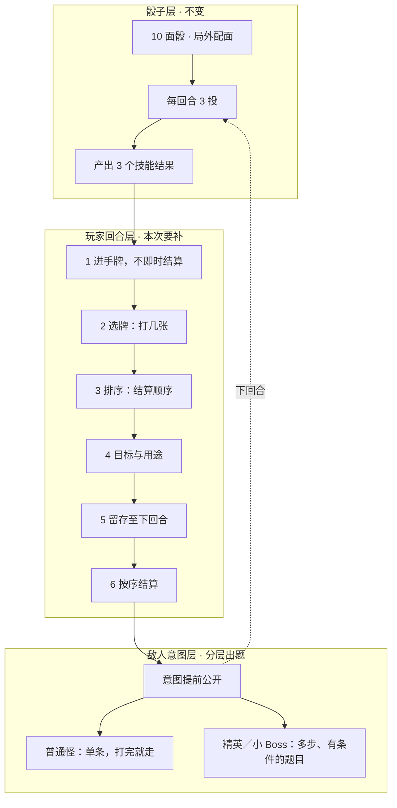

# 《概率边缘》战斗系统基础框架 · 讨论稿 v0.1

**日期**：2026-11-12　　**状态**：讨论稿，不是最终规则，也不是实现规格
**用途**：发给朋友集思广益。时间有限的话，直接看第 7 节和第 8 节。

> 一句话说明这游戏：**用骰子发牌的回合制卡牌 PVE**。骰子决定「这回合拿到什么牌」，玩家决定「这手牌怎么打」。
>
> 本文刻意写清了哪些不能改、哪些还没定。请先读第 1 节，避免把建议花在我们不会动的地方。

---

## 1. 定位与硬约束

| 项 | 内容 |
|---|---|
| 平台／规模 | Steam，纯单机 PVE，个人开发，轻量小游戏 |
| 体验目标 | 每局短、随时放下与恢复、操作与学习成本低、随机性支持重复游玩 |
| 模式 | 爬塔、剧情、无尽（先做前两种，无尽后置） |
| 世界观 | 未来融合世界（异能／灵力／西幻并存）；主角是从巨型集团实验室逃出的试验对象、无登记身份的骰子能力者 |
| 成长 | **绝无任何永久数值成长**。局外只有成就解锁技能／插件／骰子等玩法内容，局内强化每局重置 |

**提建议时请避开以下已拍板的约束：**

1. 开局一颗 **10 面骰**，每个面对应一个技能；剑／盾／心是无限量基础面，可贴任意面；其他技能靠局外成就解锁，**开局前配置**。
2. **局内不新增骰面、不重新贴面**；局内只能强化或改变已有技能的形态。
3. 每回合基础 **3 投**（暂定）；护盾每回合清零，生命跨战斗保留。
4. 敌人**下一步行动提前公开**（意图系统），不做隐藏信息。
5. 不依赖匹配其他玩家，不做 PVP。
6. **普通小关卡打得快是设计目标，不是缺陷**；思考量集中在精英怪与小 Boss。

另外有五项局内获得的概率型被动（战吼、蓄能、屏障、招架、回响），不占骰面；增益称「插件」，分 S/A/B/C 四级；技能形态用Ⅰ／Ⅱ命名。这些是既有的外围系统，本文讨论的是战斗主循环，不涉及它们的数值。

---

## 2. 当前进度（重要，别把设计当成已上线）

已有一个 Unity 2022.3 原型：第一章《出逃》5 关 50 节点（12 场战斗、12 个补给、5 个 D20 奇遇），Mac／Windows v0.2.0 试玩包可运行，存档支持逐动作恢复。

但**本文第 3、4 节描述的「手牌／选牌／排序／留存」尚未写进代码**。现有实现里：

- 投一个骰面就立刻结算一次：盾直接加护盾、心直接回血、剑／枪击选完目标直接扣血。3 投是 3 次互相独立的即时事件。
- 精英怪和普通怪用的是同一个模板结构，只是血更厚、`actions` 数组更长、数字更大；「蓄力／准备」目前只写一行日志，不构成可干预的状态。

所以本文是一份**待验证的框架提案**。所有数值（剑 8／盾 6／心 8／枪击 11、敌人生命与伤害等）都是蒙特卡洛模拟调出来的测试起点，没有经过真人平衡，改规则后必须重算。

---

## 3. 基础框架：三层

- **骰子层（不变）**：特色所在。和「洗牌抽牌」不同，骰面技能不保证一个循环里都出现，可能连续几回合摸不到某个技能。
- **玩家回合层（本次核心）**：卡牌底子。把「结果即时生效」改成「进手牌，由玩家排布」。
- **敌人意图层**：信息层。普通怪给一条，精英／小 Boss 给题目。

三层之间不动的东西：骰子怎么产生结果、局外怎么配面、敌人怎么预告。要补的只有中间那一层。

---

## 4. 玩家回合内到底做什么

| # | 动作 | 玩家在想什么 |
|---|---|---|
| 1 | **进手牌** | 3 投结果先摊在手里，不立刻生效 |
| 2 | **选牌**：打几张、打哪几张 | 受行动预算限制；「这张留着还是现在用」 |
| 3 | **排序**：决定结算顺序 | 先破盾还是先输出？先上增益还是先打？ |
| 4 | **目标与用途** | 打谁、打本体还是部件、用在数值还是效果上 |
| 5 | **留存**：最多 1 张到下回合 | 攒一波爆发，还是这回合全打完 |
| 6 | **按序结算** → 敌人按意图行动 | 验证自己的排法 |

这六个动作是本次要补的全部内容，**不新增任何玩法系统**（没有棋盘、没有站位、没有新资源条）。

其中 2、3、5 是核心：现在战斗之所以「没什么可想」，正是因为这三件事都不存在。弃牌换资源、透支行动预算、押注这类**风险动作**属于二期，且倾向只在精英战开放，不拖慢普通战。

---

## 5. 分层设计：普通战快，精英战出题

**规则只有一套，题目分层。** 玩家只需要学一次操作；思考量随敌人强度上升，而不是所有战斗一起变慢。

核心原则：**每条精英机制都必须绑定一个玩家动作**。否则它只是加血加伤害，玩家该按的键一个没变，精英战会退化成「更长的普通战」。

| 精英／小 Boss 的题目 | 逼玩家动哪个操作 | 举例 |
|---|---|---|
| 破盾窗口：破盾后本回合后续攻击增伤／打断蓄力 | 排序 | 「护盾 10，本回合内破盾则重击被取消」 |
| 蓄力可干预：用指定类别结果能推迟或削弱重击 | 目标与用途 | 「蓄力中；本回合受到枪击则延后一回合」 |
| 条件反制：本回合打出第 N 张牌时触发反制 | 选牌、何时停手 | 「你打出第 3 张牌时，它会反击」 |
| 多部位／随从：护盾发生器、召唤物 | 目标 | 先拆发生器还是先打本体 |
| 阶段阈值：血量过半换一套意图组 | 留存 | 攒一波爆发直接跨过阶段 |

---

## 6. 一个示例回合（用现有数值，方便你判断好不好玩）

**敌人**：精英锁卫，当前是 `架护盾 10 → 蓄力 → 重击 36`。改成题目版：

> 本回合架起 10 点护盾。**若本回合内破盾，蓄力被打断，下回合只出 8 点**；否则下回合 36 点。

**手牌**（3 投）：剑 8／盾 6／剑 8。假设行动预算是「打 2 张」。

| 打法 | 结果 |
|---|---|
| 剑 + 剑 | 合计 16，破盾余 6 伤害，**打断蓄力** → 下回合只吃 8，一张盾基本挡完 |
| 剑 + 盾 | 只有 8，破不了盾 → 下回合 36 − 6 = 30 |
| 只打盾，留 1 张剑 | 这回合稳，但下回合要同时破盾和挡重击 |
| 若再加「破盾后本回合后续攻击 +X」 | 先剑后剑才吃得到加成，**顺序第一次值钱** |

一个回合里三四条路线，输赢能归因到自己的排法。而普通巡检机只有「攻击 13」，玩家 3 投打完就走，快得理直气壮。

请特别判断：**这个回合你会想停下来算吗？还是一眼就看到唯一最优解？** 后者的反馈对我们最有用。

---

## 7. 已定 / 建议 / 待定

| 状态 | 内容 |
|---|---|
| **已定** | 第 1 节全部硬约束；三模式；敌人意图公开；每场剧情战斗后跟补给节点；无永久数值成长 |
| **设计倾向（未拍板）** | 3 投结果进手牌、每回合打 2 张；留存最多 1 张且不跨战；每条精英机制绑定一个玩家动作；赌博感收编为回合内风险动作、只在精英战开放 |
| **待定** | 行动预算具体形态；顺序敏感效果的种类与数量；留存细节；赌注用什么当筹码；坏骰兜底；精英题目先做哪一类；意图的展示复杂度上限；手牌组合数随局外解锁膨胀后的可读性 |

---

## 8. 征求意见

**目前这个框架最薄弱的地方**（欢迎直接针对这些开火）：

1. 顺序敏感的效果可能太少，排序容易退化成固定解，玩家算一次就再也不想了。
2. 原型只有 4 个技能、每回合 3 张牌，组合空间小，「选牌」可能没得选。
3. 留存需要和「随时放下、学习成本低」的轻量定位共存，规则一多就变重。
4. 精英题目容易做成「唯一正解」，反而比随机更无聊。
5. 赌注筹码没定，赌博感可能又变成纯开奖。
6. 一回合里玩家该算几条分支？信息怎么展示才不啰嗦（原型目前是纯文字界面）。
7. 爬塔每层要实际走 20～30 节点，回合内操作变重后是否会疲劳。

**具体问题**（请标编号回答）：

- **Q1 行动预算（最要紧）**：A. 3 投全进手牌、每回合打 2 张（当前倾向）；B. 3 张都能打、各带费用；C. 其他。A 取舍最硬，但可能常出现「三张都想要」的憋屈；B 更灵活，代价是多学一套费用规则。
- **Q2 排序**：需要哪些顺序敏感效果才够撑起一个决策？只有一种会不会立刻被算成固定解？有没有你见过处理得好的游戏（请写游戏名）？
- **Q3 留存**：留 1 张还是更多？能不能跨战斗？会不会导致攒牌摆烂？留存要不要占下回合的手牌位？
- **Q4 精英题目**：第 5 节那五类，哪类最耐玩？哪类最容易变成唯一正解？如果只能先做一类，选哪个？
- **Q5 赌博感**：赌注该用什么（已投出的结果／生命／护盾／行动预算）？只在精英战开放还是全局？怎么避免「算不出概率的抽奖」？
- **Q6 坏骰兜底**：3 张都用不上时，玩家该有保底动作吗（弃牌换资源／重投／转化）？没有会不会挫败，有了会不会让局外构筑失去意义？
- **Q7 可读性**：条件意图最多几条？纯文字界面能承载多复杂的信息？你会不会觉得要记的东西太多？
- **Q8 长线**：这套回合内操作放进爬塔（20～30 节点／层）会不会累？局外解锁更多技能后，手牌组合变多，怎样保持一眼可读？

**最想要的反馈形式**：具体反例（「这样会导致……」）、可玩性风险、以及别的游戏里验证过的做法（注明游戏名）。最不缺的是「再加个系统／再加点内容／再加随机」——第 1 节的硬约束决定了这些暂时用不上。

最后附一句就更好：**你觉得第 6 节那个回合里，最好玩的一下是哪一下？** 这能帮我们确认核心乐趣到底成不成立。

---

## 附：术语表

| 词 | 意思 |
|---|---|
| 骰面／贴面 | 10 面骰上的一格，对应一个技能，局外配置 |
| 手牌 | 本回合 3 投产出的技能结果，尚未结算 |
| 行动预算 | 一回合允许打出的牌数或费用 |
| 意图 | 敌人下一步行动，提前公开 |
| 题目 | 精英／小 Boss 给出的多步或有条件意图，用来逼出玩家的某个操作 |
| 插件 | 局内增益，分 S/A/B/C 四级，不叫遗物 |
| 形态 | 技能的Ⅰ／Ⅱ两种变体，局内可改变，不新增骰面 |
| 概率被动 | 战吼、蓄能、屏障、招架、回响，局内获得，不占骰面 |
